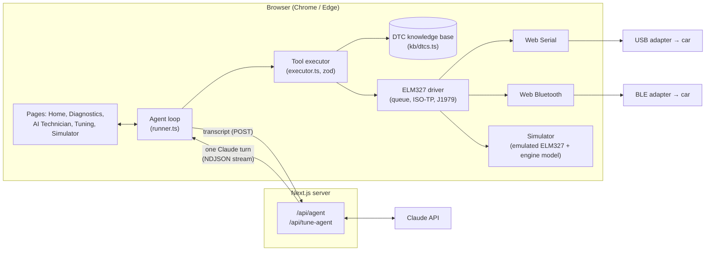

# Torque: AI diagnostic technician

Plug a $20 OBD-II adapter into a car, open a browser tab, and an AI agent diagnoses it like a master technician. It reads the codes, then **runs live tests on the engine** ("hold 2500 rpm while I watch the fuel trims") to tell causes apart before it gives an answer.

Built for the AITX & MLOps World Community Hackathon, **Antler agents track**.

**Contents:** [Quick start](#quick-start) · [Reproduce the demo](#reproduce-the-demo) · [Tech stack](#tech-stack) · [Architecture](#architecture) · [Datasets and synthetic data](#datasets-and-synthetic-data) · [Known limitations](#known-limitations) · [Next steps](#next-steps)

## Why it's more than a code reader

A P0171 "system too lean" code has at least five common causes, from a $5 vacuum hose to a $400 fuel pump. A code reader stops at the code. Torque's agent:

1. Reads stored, pending and permanent codes, plus the freeze-frame data, VIN and battery voltage.
2. Pulls ranked causes and the *discriminating tests* for each cause from a local repair knowledge base.
3. Designs an experiment and asks the driver to change engine state (idle, 2500 rpm, cruise, snap throttle).
4. Samples live PIDs during each condition and computes statistics: mean, spread, trend, and O2 sensor switching frequency.
5. Reasons over the numbers. For example, "LTFT +17% at idle drops to +8% at 2500 rpm, so this is a vacuum leak and not the MAF." It submits a report with ranked root causes, the evidence for each, the causes it ruled out, step-by-step fixes, a parts list with prices, and labor hours.

## Quick start

Requirements: Node.js 20+ (tested on 22), Chrome or Edge, and an Anthropic API key.

```bash
git clone https://github.com/jsaltel/AntlerHacks.git
cd AntlerHacks
npm install
cp .env.example .env.local   # then paste your key into ANTHROPIC_API_KEY
npm run dev                  # open http://localhost:3000 in Chrome or Edge
```

No car or adapter is needed: the simulator is the default connection. On the home page press the one-click simulator demo, or go to **AI Technician**, press **Connect**, then **Diagnose**.

Production build:

```bash
npm run build && npm start
```

## Reproduce the demo

### Environment variables

| Variable | Required | Where it's used | Notes |
|---|---|---|---|
| `ANTHROPIC_API_KEY` | Yes | `src/lib/agent/stream.ts` (server only) | Read by the Anthropic SDK in the `/api/agent` and `/api/tune-agent` routes. It is never sent to the browser. Get one at https://console.anthropic.com. |
| `ANTHROPIC_MODEL` | No | `src/lib/agent/stream.ts` | Defaults to `claude-opus-5-5`. The request also enables server-side model fallback. |

Sample `.env.local` (the same as `.env.example`):

```bash
# Anthropic API key used by the server-side agent routes (never sent to the browser)
ANTHROPIC_API_KEY=sk-ant-...
# Optional model override (default: claude-opus-5-5)
# ANTHROPIC_MODEL=claude-opus-5-5
```

No other keys or accounts are needed. The 3D car models load from Sketchfab's public embed API without a key.

### Demo script (simulator, about 3 minutes)

1. `npm run dev`, open http://localhost:3000 in Chrome or Edge.
2. **AI Technician** (`/technician`): leave the scenario on **Mystery car** (a random fault, revealed after the diagnosis) or pick one, for example **Lean at idle**. Press **Connect**, then **Diagnose**.
3. Watch the agent read codes and freeze frame, look up P0171/P0174, sample fuel trims at idle, ask you to hold 2500 rpm (confirm the prompt), sample again, and submit a report that rules out the dirty MAF from the numbers. The panel shows token use, cache hits and cost.
4. **Diagnostics** (`/diagnostics`): live gauges, charts and the raw ELM327 wire log from the same session.
5. **Tuning** (`/tune`): pick a car, fuel and goal. Four agents plan, calibrate, stress-test and QA a tune on the simulated engine.
6. **Simulator** (`/sim`): drive the stock or saved tune, inject faults, and compare across conditions.

### Demo on a real car

1. Plug a USB ELM327 or OBDLink adapter into the car's OBD-II port and the laptop. Ignition on; engine running for the live tests.
2. Pick **USB adapter** and choose the port (Web Serial; baud is auto-detected at 38400, 115200 or 9600). BLE adapters work through **Bluetooth** (Web Bluetooth).
3. Web Serial and Web Bluetooth need Chrome or Edge on `localhost` or HTTPS.

### Tests (no API key needed)

```bash
npx tsx scripts/sim-smoke.ts      # full ELM327 driver against every simulator scenario
npx tsx scripts/engine-check.ts   # stock dyno, drag and safety results for every car and condition

# Full UI + agent tool loop with a scripted stand-in for Claude (needs Playwright)
npm i --no-save playwright && npx playwright install chromium
npm run build && npx next start -p 3100 &
node scripts/e2e-mock.mjs out.png
```

## Tech stack

* **App:** Next.js 15 (App Router), React 19, TypeScript, Tailwind CSS 4.
* **AI:** Claude via `@anthropic-ai/sdk`, using tool use, adaptive thinking with streamed summaries, effort control, prompt caching and server-side fallback. Tool inputs are validated with zod.
* **Hardware:** a hand-written ELM327 driver over Web Serial (USB) and Web Bluetooth (BLE), with SAE J1979 modes 01/02/03/04/07/09/0A and ISO-TP multi-frame reassembly.
* **Simulation:** an ELM327 v1.5 emulator with a fault-injected engine model, and a mean-value engine and vehicle model for tuning and driving.
* **Charts and 3D:** custom SVG charts; Sketchfab Viewer API for the embedded 3D cars.
* **Storage:** none server-side. Saved tunes live in the browser's `localStorage`.

## Architecture



* **Tools run where the hardware is.** The model runs server-side (the API key never reaches the browser), but its tools execute in the browser, next to the adapter. Each step posts the transcript to `/api/agent`, which streams one Claude turn back as NDJSON. The browser runs the tool calls against the car and posts the results, until the agent calls `submit_diagnosis`.
* **One protocol stack for all transports.** The simulator emulates an ELM327 v1.5 *on the wire*: AT commands, the `>` prompt, headers-off hex and ISO-TP multi-frame responses. The demo therefore runs the exact same driver code as a real car.
* **A physically plausible fault model.** Fuel trims respond to airflow, O2 sensors switch with load, and coolant warms up over time. A vacuum leak and a dirty MAF both set P0171/P0174, but they behave differently at 2500 rpm, so the agent has to run the test to tell them apart. Cleared codes come back as pending and then stored while the fault persists.
* **Safety rails.** Clearing codes needs explicit approval in the UI. Driver actions are prompts the person confirms, and tool inputs are schema-validated before execution.
* **Observability.** The UI shows tokens, cache hits and the cost of each diagnosis and tune, along with the raw ELM327 wire log.

### Agent tools (diagnostics)

| Tool | What it does |
|---|---|
| `get_vehicle_info` | VIN (mode 09), adapter version, protocol, battery voltage, supported PIDs |
| `read_dtcs` | Stored, pending and permanent codes (modes 03/07/0A) |
| `read_freeze_frame` | Snapshot taken when the code set (mode 02) |
| `read_live_data` | One reading of up to 12 PIDs (mode 01) |
| `monitor_pids` | Samples up to 6 PIDs for 2–30 s and returns mean, min/max, spread, trend and O2 switching rate |
| `request_driver_action` | Asks the person to idle, hold 2500 rpm, cruise or snap the throttle |
| `lookup_dtc` | Causes, discriminating tests and cost range from the local knowledge base (works with no car connected) |
| `clear_dtcs` | Clears codes (mode 04), only after the person approves in the UI |
| `submit_diagnosis` | Final structured report that the UI renders |

The tuning lab is a second multi-agent system: a lead tuner, a calibration engineer, a simulation engineer and a QA and safety reviewer, each with its own prompt, tools and effort level (`src/lib/tune/team.ts`). They run a plan → calibrate → simulate → QA loop for up to three rounds (`src/lib/tune/pipeline.ts`) against the engine model through `/api/tune-agent`.

### Code map

| Path | What it is |
|---|---|
| `src/lib/obd/elm327.ts` | ELM327 driver: command queue, prompt framing, multi-frame reassembly, modes 01/02/03/04/07/09/0A |
| `src/lib/obd/simulator.ts` | Engine model + ELM327 emulator with 6 scenarios |
| `src/lib/obd/serial.ts`, `ble.ts` | Web Serial (baud auto-detect) and Web Bluetooth transports |
| `src/lib/kb/dtcs.ts` | Repair knowledge base: causes, discriminating tests, costs |
| `src/lib/agent/tools.ts` | Tool contract + system prompt (shared by server and browser) |
| `src/lib/agent/runner.ts`, `executor.ts` | Browser-side agent loop and tool execution |
| `src/lib/agent/stream.ts` | Shared NDJSON streaming of one Claude turn |
| `src/app/api/agent/route.ts`, `api/tune-agent/route.ts` | Claude streaming endpoints (diagnostics, tuning team) |
| `src/lib/sim/engine.ts` | Engine + vehicle physics: VE, turbo spool, intake heat, injectors, spark vs knock limit, EGT, dyno, drag strip |
| `src/lib/tune/team.ts`, `workbench.ts`, `pipeline.ts` | Tuning agents, tool execution with the QA safety gate, and the multi-round loop |
| `src/components/DiagnosticsProvider.tsx` | Shared adapter connection and agent state across pages |
| `src/components/SketchfabCar.tsx` | Embedded Sketchfab 3D cars: camera views and paint via the Viewer API |

### Pages

* **Home** (`/`): get-started guide (get an adapter, plug it in, connect, ask the technician) and a one-click simulator demo.
* **Diagnostics** (`/diagnostics`): connection, live gauges and charts, trouble codes and the wire log.
* **AI Technician** (`/technician`): chat with the technician (works without a car, too) or run a full diagnosis. Both tabs share one adapter connection, so a diagnosis keeps running when you switch tabs.
* **Tuning** (`/tune`): the four-agent tuning team, plus hand editing of the spark, AFR and boost maps. Approved tunes export as a JSON package or go to the simulator. Tunes stay virtual: emissions controls are never touched.
* **Simulator** (`/sim`): five cars (Civic Si, GTI, Mustang GT, Alfa Romeo Giulia Quadrifoglio, Jeep Wrangler Rubicon JK). Drive in real time (throttle slider, arrow keys, auto launch or cruise) with stock or saved tunes, change conditions, inject faults (clogged injectors, boost leak, heat soak, bad fuel) and compare stock vs tune across a test matrix.

## Datasets and synthetic data

The project uses **no external training data and no personal or vehicle data from real owners**. Everything the agent sees in the demo is either hand-curated reference data or synthetic data generated at runtime. Nothing is fine-tuned; Claude is used as-is.

| Data | Location | What it is | Provenance |
|---|---|---|---|
| DTC repair knowledge base | `src/lib/kb/dtcs.ts` | 24 OBD-II codes (P0101, P0128, P0133, P0135, P0171, P0172, P0174, P0217, P0300–P0308, P0401, P0420, P0430, P0442, P0455, P0505, P0562, P0700). Each has a title, system, severity, ranked causes, *discriminating tests* (how live data separates the causes) and a USD cost range. | Hand-written for this project from general automotive repair knowledge: SAE J2012 code definitions and widely published service practice (fuel-trim, O2 and thermostat diagnostics). Cost ranges are rough US parts-plus-labor estimates, not quotes. Unknown codes fall back to the SAE J2012 code family (for example "Ignition system or misfire") and a manufacturer-specific flag. |
| Simulator fault scenarios | `src/lib/obd/simulator.ts` | 6 scenarios: vacuum leak (P0171/P0174), dirty MAF (P0171/P0174 + pending P0101), cylinder 3 misfire (P0303/P0300), catalyst efficiency (P0420), thermostat stuck open (P0128), healthy. Each has stored and pending codes, a freeze frame, and fault-specific behavior for RPM, fuel trims, MAF, O2 sensors and coolant. "Mystery car" picks one of the five faults at random. | Synthetic. Values are generated live by a hand-built engine model whose behavior follows the textbook failure signatures in the knowledge base (for example, vacuum-leak trims fall as airflow rises; a dirty MAF under-reads by about 28%). Freeze frames are hand-authored to match. Random noise is added to every reading. The simulator VIN `1HGCM82633A004352` is the public sample VIN used in NHTSA documentation, not a real customer's car. |
| Engine and vehicle presets | `src/lib/sim/engine.ts` | 5 cars with displacement, compression, redline, boost, injector size, mass, gearing, drag and drivetrain data, and 5 test environments (standard, hot day, 87 octane, 1600 m altitude, track heat soak). | Approximated from publicly available manufacturer specifications and enthusiast references. A per-engine calibration factor is tuned so stock dyno output lands near the factory rating; run `scripts/engine-check.ts` to see the results. Internals and turbo limits are estimates. |
| 3D car models | Embedded at runtime from Sketchfab | Alfa Romeo Giulia Quadrifoglio by MaximePages; Jeep Wrangler Rubicon JK (2017) by ROH3D. | The creators' work, streamed through the Sketchfab Viewer API. They are embedded, not copied into this repo. |
| Agent transcripts and tunes | Browser memory and `localStorage` | Conversations, diagnoses and saved tunes. | Generated by the user's session. Nothing is stored server-side; transcripts are sent to the Anthropic API for each step. |

## Known limitations

* **Browser support:** Web Serial and Web Bluetooth only work in Chromium browsers (Chrome, Edge) on `localhost` or HTTPS. Safari and Firefox can use the simulator only.
* **Adapters:** tested against the simulator and ELM327-compatible adapters. BLE support covers adapters that expose the common `FFF0` or `FFE0` serial services. Classic Bluetooth adapters need to be paired as a serial port first. Cheap ELM327 clones vary in which commands they support.
* **Generic OBD-II only:** standard SAE J1979 modes and PIDs. No manufacturer-specific PIDs (mode 22), no ABS, airbag or body modules, and no bidirectional controls.
* **Knowledge base depth:** 24 codes have full discriminating tests. Other codes get only their J2012 family, so the agent falls back on Claude's general knowledge and flags lower confidence. Costs are rough US estimates.
* **Simulator realism:** each scenario is a single fault on one generic engine. Real cars can have several interacting faults, sensor noise patterns and warm-up behavior the model doesn't capture.
* **Driver actions are trusted:** the agent can't verify that the person actually held 2500 rpm, though it checks the RPM samples it collects.
* **Not a substitute for a mechanic:** the report is decision support. Safety-critical findings (overheating, flashing check engine light) tell the driver to stop, but nothing is guaranteed.
* **Tuning is virtual:** the engine model is a mean-value approximation, and tunes are never written to a real ECU (an ELM327 can't flash maps).
* **No accounts or history:** diagnoses aren't saved between sessions, and the API routes have no auth or rate limiting, so a public deployment would need both.
* **Cost and latency:** a full diagnosis takes several model turns. Prompt caching keeps cost down, but expect tens of seconds and a few cents to tens of cents per run, shown live in the UI.

## Next steps

* Decode the VIN (NHTSA vPIC) to tailor causes and costs to the exact make, model and engine, and pull open recalls and TSBs.
* Add manufacturer-specific PIDs (mode 22) and more modules (transmission, ABS, BMS for EVs and hybrids).
* Grow the knowledge base from service data, and evaluate the agent against a labeled set of simulator and real-car cases (accuracy of top-1 root cause, tests run, cost per diagnosis).
* Multi-fault and intermittent-fault simulator scenarios, plus recorded real-car sessions replayed through the same driver.
* Save diagnosis history per vehicle, and export a shareable report for a shop or a used-car buyer.
* Local parts pricing and nearby shop quotes for the recommended repair.
* A mobile companion app that talks to BLE adapters directly.
